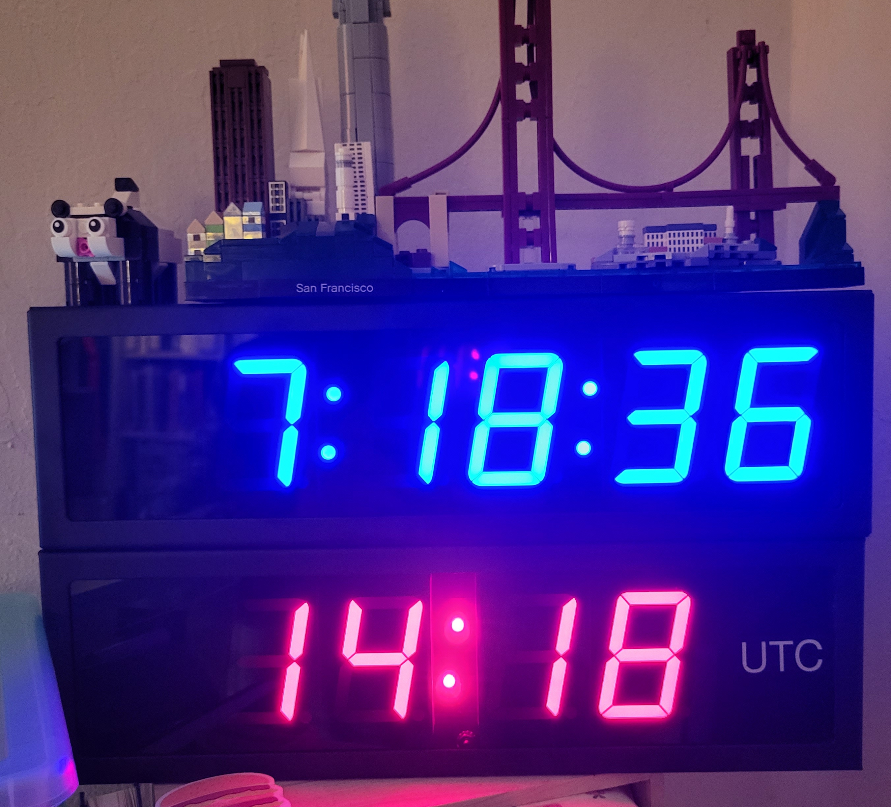
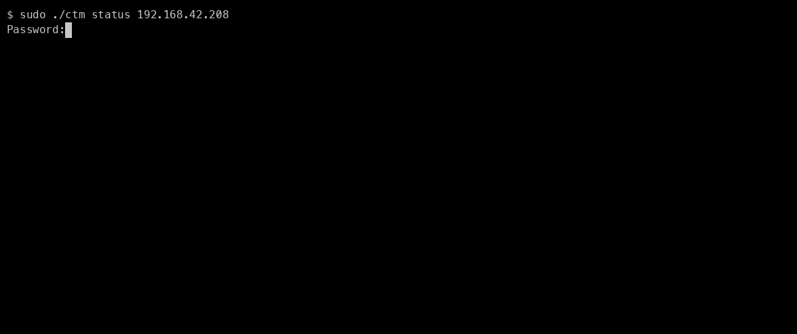
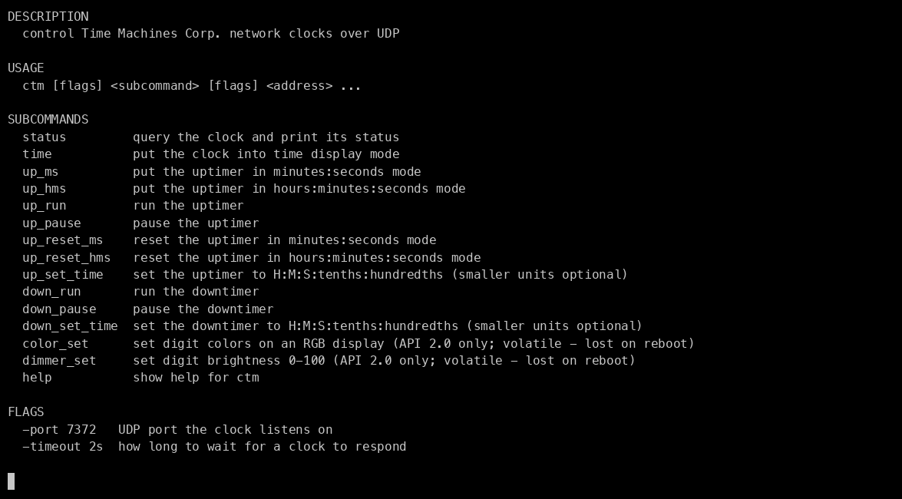
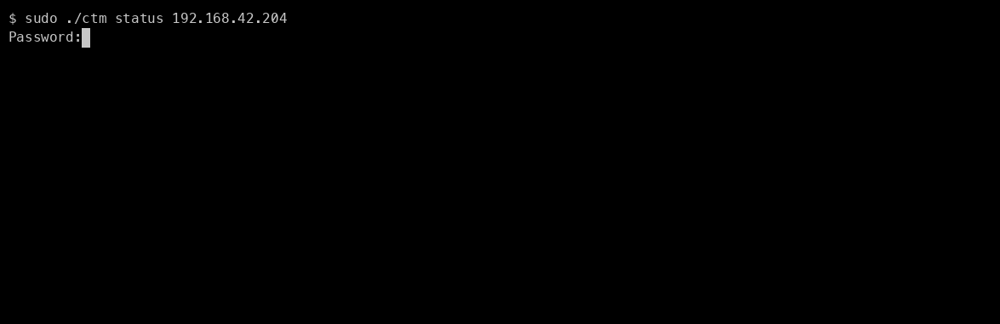
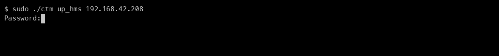
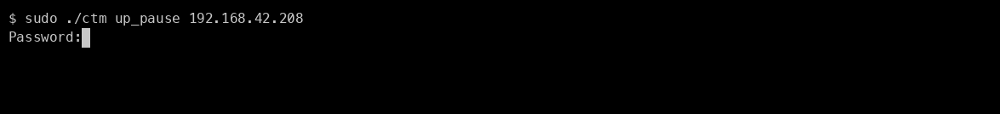
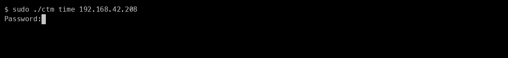
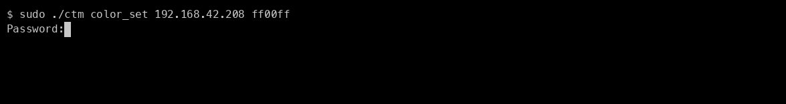
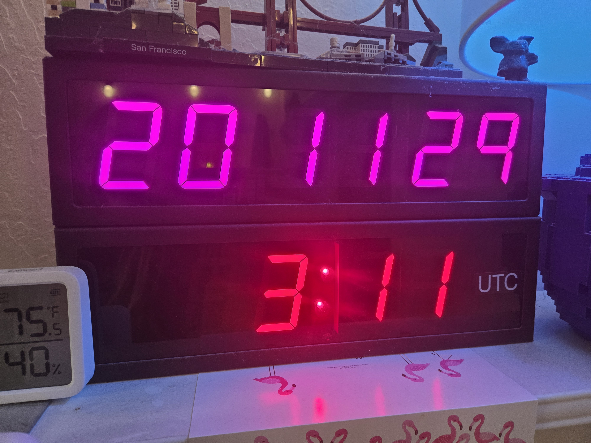

<!-- markdownlint-disable MD033 -->
# ctm = Control Time Machines

[](https://github.com/chicks-net/ctm/releases/latest)
[](LICENSE)
[](https://scorecard.dev/viewer/?uri=github.com/chicks-net/ctm)
[](https://www.bestpractices.dev/projects/14822)

**ctm** controls [Time Machines Corp.](https://timemachinescorp.com)
PoE network clocks from the command line - status, timers, colors, and
brightness, over UDP.

What works:

- status queries against API 1.x and API 2.0 clocks
- uptimers (API 1.x and 2.0) and downtimers (API 2.0)
- RGB digit colors and brightness dimming (API 2.0 RGB models)





## Install

Via Homebrew (macOS/Linux, amd64/arm64):

```bash
brew install chicks-net/chicks/ctm
```

This installs a prebuilt binary from the
[GitHub release](https://github.com/chicks-net/ctm/releases); on other
platforms it falls back to building from source with `go`.

I'd like to get this into Debian eventually too, but for now you can
also build the program yourself.  In the main repo directory either of
these will build `ctm` for your platform:

```bash
just build   # via the justfile (also: just test, just fmt)
make         # via the Makefile
```

## macOS note: Local Network permission

macOS 15 (Sequoia) and later gate LAN UDP traffic behind the Local
Network permission, and locally built binaries never get the prompt -
clock writes just fail with `broken pipe`.  Details and workarounds
below.

<details>
<summary>Details &amp; workarounds</summary>

macOS 15 (Sequoia) and later gate UDP traffic to machines on your local
network behind the Local Network privacy permission.  The permission is
granted per *binary*, and Apple-signed system tools are exempt - the rest
of us have to ask.  A `ctm` you build yourself (`just build` or `make`)
is only ad-hoc signed (`codesign -dv ./ctm` shows
`flags=0x20002(adhoc,linker-signed)`), and macOS never even shows the
"allow local network" prompt for ad-hoc binaries, so writes to a LAN
clock just fail:

```ScreenOutput
ctm: sending status query to 192.168.42.208:7372: write udp ...: write: broken pipe
```

(`ctm` detects exactly this failure - a write dying with `broken
pipe` - and appends a pointer back to this note, so if you've landed
here from an error message: yes, it's the permission.)

Quick sanity check that it's the permission and not your network: from
the same shell, Apple-signed tools like `/usr/bin/nc -u` reach the
clock fine while `./ctm` gets `broken pipe` on every write.  (ICMP
isn't gated, so `ping` working proves little on its own - pair it with
`nc -u`.)

This is a long-standing Go toolchain gap on macOS 15+
([golang/go#70530](https://github.com/golang/go/issues/70530)), not
something `ctm` can code its way around, so `just build` can't trigger
the normal prompt.  Workarounds, cheapest first:

- `sudo ./ctm status 192.168.42.208` - TCC exempts root, no prompt
  needed.  Fine for poking at a clock by hand, lousy for scripts.
- If you have an Apple Developer ID, sign the binary yourself with
  `codesign --force -s "Developer ID Application: YOUR NAME (TEAMID)" ctm`.
  Real signatures get the standard prompt, which you then click Allow
  on once.
- The Homebrew install doesn't save you either: release binaries aren't
  Developer ID signed yet, and Homebrew's build-from-source fallback
  ad-hoc signs on your machine too.  Follow along in
  [#34](https://github.com/chicks-net/ctm/issues/34).

</details>

## Development prerequisites

The `just` recipes need a few tools installed: `just`, `gh`,
`shellcheck`, `markdownlint-cli2`, `jq`, `gum`, `cue`, and the `gh-observer`
gh extension.  On macOS with Homebrew, `./.just/lib/install-prerequisites.sh`
checks for all of them and installs anything missing - run it once and you're
set.  The `cue` CLI is new for contributors: it validates `.repo.toml` against
`docs/repo-toml.cue` (`just cue-verify`).

## Usage

Invocation:

```bash
ctm [flags] $SUBCOMMAND [flags] $CLOCK_IP
```

Global flags (may appear before or after the subcommand, but must precede
positional args):

- `-timeout duration` - how long to wait for a clock to respond
  (default `2s`)
- `-port` - UDP port the clock listens on (default `7372`)

`ctm help` (or `ctm -h`, or `ctm $SUBCOMMAND -h`) prints usage.

Animated:



Subcommands:

| Command | API | Effect |
| ------- | --- | ------ |
| `status` | 1.x + 2.0 | query and dump the clock's status |
| `time` | 1.x + 2.0 | return to time display mode |
| `up_ms` / `up_hms` | 1.x + 2.0 | uptimer mode (MM:SS / H:MM:SS) |
| `up_run` / `up_pause` | 1.x + 2.0 | start / pause the uptimer |
| `up_reset_ms` / `up_reset_hms` | 1.x + 2.0 | reset the uptimer |
| `up_set_time` | 1.x + 2.0 | preset the uptimer |
| `down_run` / `down_pause` | 2.0 | start / pause the downtimer |
| `down_set_time` | 2.0 | preset the downtimer |
| `color_set` | 2.0 | set digit colors on RGB models |
| `dimmer_set` | 2.0 | set digit brightness (0-100) |

Argument details:

- `up_set_time H:M:S:tenths:hundredths` (and `down_set_time` for the
  downtimer, same syntax) - you can drop off any of the smaller units
  that are irrelevant to you.  If you want no hours you still need to
  start with `0:`.
- `color_set <clock_ip> rrggbb[:rrggbb]` - one color applies to all
  digits; two colors given as `rrggbb:rrggbb` set the MM:SS digits and
  the HH digits independently.  The color is volatile - it is not saved
  across a reboot.
- `dimmer_set <clock_ip> level` - the level is volatile - it is not
  saved across a reboot.

Status output looks like:

```ScreenOutput
sent status query to 192.168.42.204:7372
response hexdump:
00000000  01 c0 a8 2a cc 70 b3 d5  75 68 e2 05 00 12 2e 02  |...*.p..uh......|
00000010  2a 2c 50 4f 45 5f 43 6c  6f 63 6b 5f 55 54 43 00  |*,POE_Clock_UTC.|
00000020  00 00 00 00 00 00 00 00  00 00 00 00 00 00 00 00  |................|
packet length 35 (API version 1.x)
Type 1
IP 192.168.42.204
MAC 70b3d57568e2
Ver 0500
Syncs 4654
Time {2 42 44}
Name POE_Clock_UTC
```

Animated, querying an API 1.x clock:



Animated, querying an API 2.0 clock:


Using the uptimer looks like:

```bash
$ ./ctm up_ms 192.168.42.204
sent command up_mode_ms to 192.168.42.204:7372
acked by clock
$ ./ctm up_run 192.168.42.204
sent command up_mode_run to 192.168.42.204:7372
acked by clock
$ ./ctm time 192.168.42.204
sent command time_mode to 192.168.42.204:7372
acked by clock
```

Animated:












## Known bugs

- Coming soon:
  - [macOS Local Network permission blocks locally built binaries](https://github.com/chicks-net/ctm/issues/34) - see the
    [macOS note](#macos-note-local-network-permission) above
- Unimplemented:
  - setting dotmatrix text - I don't have [a device to test this](https://timemachinescorp.com/timezone-dot-matrix-network-clocks/) with yet.
  - exec stored program (API2.0)
  - relay close (API2.0)

## References

- TimeMachinesCorp API documentation:
  - [Locator Protocol API v2.0](https://www.timemachinescorp.com/wp-content/uploads/TimeMachinesControlAPI.pdf)
- I don't have a URL for the API v1.1 docs, but TimeMachinesCorp sent me a copy
  and not much has changed.
- [Glen Gorton's project](https://github.com/ggmp3/Q-SYS-CSS-TimeMachines-Clock-B-Series-)
  is the other repo on github for these clocks.  It looks pretty cool actually,
  but the language is obscure to me and I'm unlikely to license the development
  environment just to try this out.
